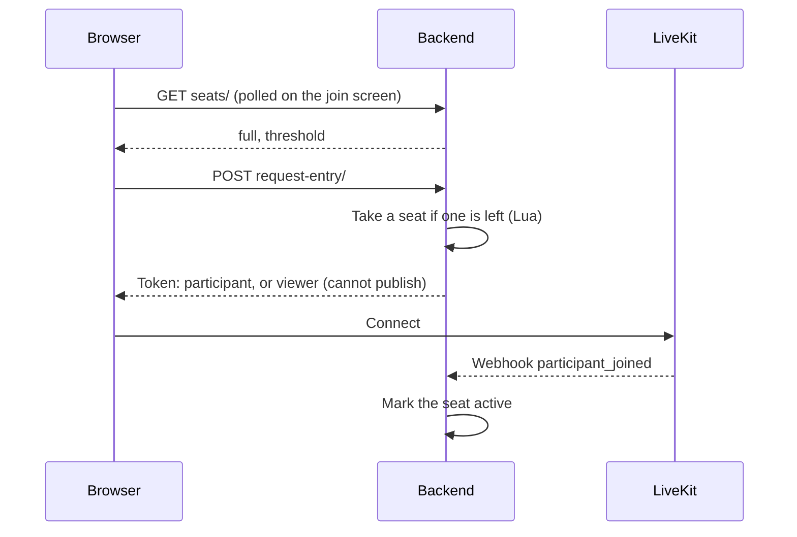

# Viewers (Beta)

Let large audiences follow a meeting: beyond a number of people who can speak, people joining become viewers. Viewers see and hear the meeting, chat, react and raise their hand, but publish nothing. An authenticated participant can let a viewer speak.

**Current Limitations**:

* Only registered rooms have viewers, not rooms created on the fly from an unregistered link.
* A signed-in user has the same identity in every tab, so two tabs of theirs in the same meeting disconnect each other, as without viewers.

## Special requirements

* Webhook events configured between the LiveKit server and the backend: seats follow `participant_joined`, `participant_left`, `participant_connection_aborted` and `room_finished`. When the room looks full, the backend also checks the seats against the participants LiveKit reports, at most once per `VIEWERS_RECONCILE_INTERVAL`, so that lost webhooks do not hold seats forever.
* Selective subscriptions (`FRONTEND_SELECTIVE_SUBSCRIPTION_THRESHOLD`) are strongly advised: without them, every viewer subscribes to every track of every participant.

## Settings

| Setting                          | Description                                                                  | Default    |
|----------------------------------|------------------------------------------------------------------------------|------------|
| `VIEWERS_ENABLED`                | Enable viewers                                                               | false      |
| `VIEWERS_DEFAULT_THRESHOLD`      | Number of people who can speak, unless the meeting sets its own              | 50         |
| `VIEWERS_PENDING_SEAT_TIMEOUT`   | Seconds a seat is held for someone who got a token but has not joined yet    | 120        |
| `VIEWERS_RECONNECT_GRACE_PERIOD` | Seconds a seat is kept for a participant who disconnected                    | 120        |
| `VIEWERS_RECONCILE_INTERVAL`     | Minimum seconds between two checks of the seats against LiveKit              | 15         |
| `VIEWERS_KEY_PREFIX`             | Prefix of the Redis keys holding the seats                                   | room_seats |

Owners and administrators set the number of people who can speak of their meeting in the meeting admin panel (`viewers_threshold` in the room configuration). A new value applies to the next arrivals: nobody changes role.

## How It Works

### Seats

The seats of a room live in Redis: a sorted set maps each holder's LiveKit identity to the time its seat expires, and a hash keeps their participant sid and whether they are authenticated or a phone caller. Every operation is a Lua script, so concurrent arrivals cannot take more seats than the room has.

A seat is:

* **pending** once a token is issued, until its holder joins (`VIEWERS_PENDING_SEAT_TIMEOUT`);
* **active** while its holder is connected;
* **kept** for `VIEWERS_RECONNECT_GRACE_PERIOD` once its holder disconnects, so that a reconnection or a reload gets it back. A participant removed from the meeting loses it at once.

Owners, administrators and phone callers always speak: their seat is counted when they join, even beyond the threshold. Letting a viewer speak is also allowed beyond the threshold.

### Joining

In a room with viewers, reading a room only gives a token to its owners and administrators: a token issued on every read would hold a seat for nothing. Everyone else joins through `request-entry`, which admits them at once unless they have to wait in the lobby.

The identity of a signed-out person is derived from the signed lobby cookie and an id each tab keeps in its session storage: each tab of a browser joins as its own participant, and a tab reloaded within the grace period gets its seat back.

Tokens carry a `viewer` attribute, read by every client. A viewer's token grants no source to publish.

### Changing role

| Endpoint                     | Who                                                                                     | What                                                                                                            |
|------------------------------|-----------------------------------------------------------------------------------------|-----------------------------------------------------------------------------------------------------------------|
| `POST promote-viewer/`       | Authenticated participants, owners, administrators                                      | The viewer gets a seat, the publishing rights of the room, and their hand is lowered                             |
| `POST demote-participant/`   | Anyone for themselves (LiveKit token); authenticated participants for someone else      | The participant goes back to viewers. Refused to the last authenticated participant connected, and for phone callers; only owners and administrators can send back an owner or administrator |
| `POST take-seat/`            | An authenticated viewer, while no authenticated participant is connected                | The viewer takes the seat of an unauthenticated participant, who becomes a viewer                                |

Seats change first, then the LiveKit permission and the `viewer` attribute. LiveKit replaces a permission as a whole, so every field is given. When LiveKit fails, the seats are put back. When a participant holding a seat joins with a viewer token, for instance after a reconnection that missed the refreshed token, their rights are given back.

### What viewers cannot do

The backend checks the seats, not the token, whose grants may predate a demotion:

* mute a participant;
* start the subtitles (they can show subtitles already started);
* let people in from the lobby of a trusted room;
* get publishing rights through `update-participant`.

The subtitle agent does not transcribe viewers.
